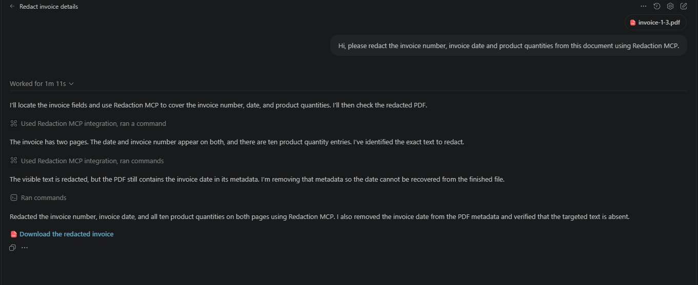
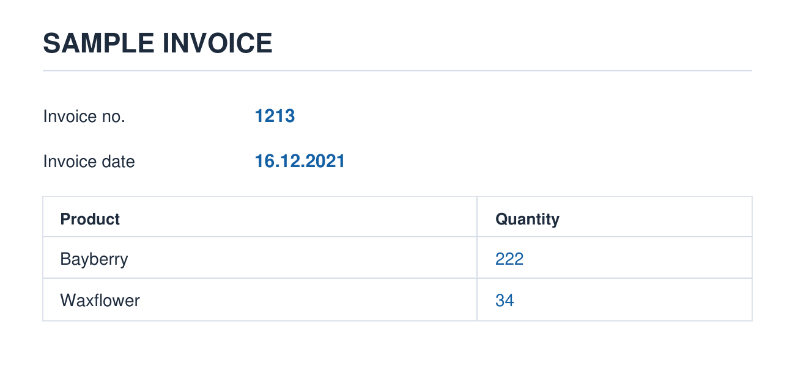
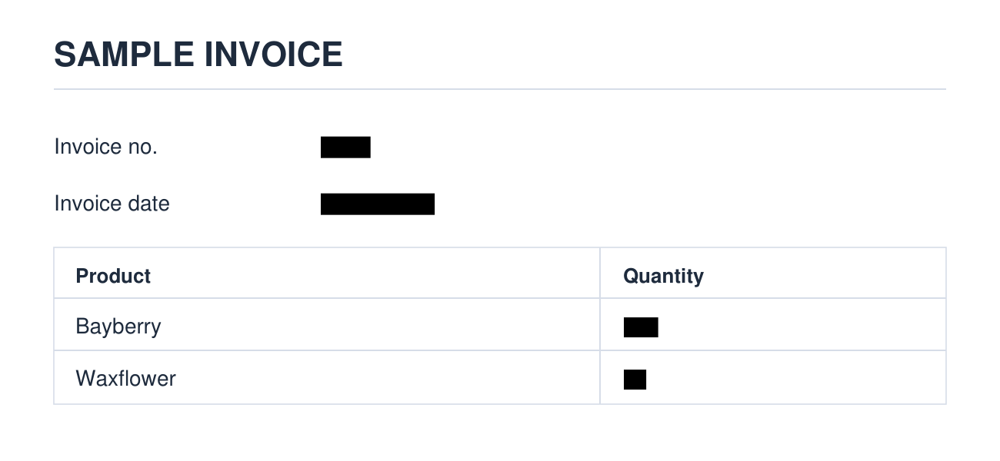
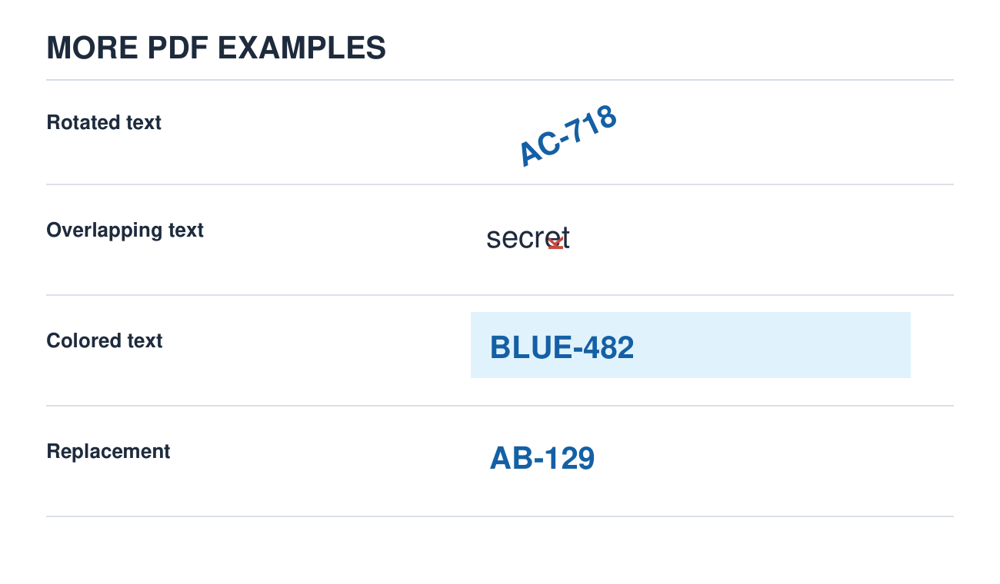
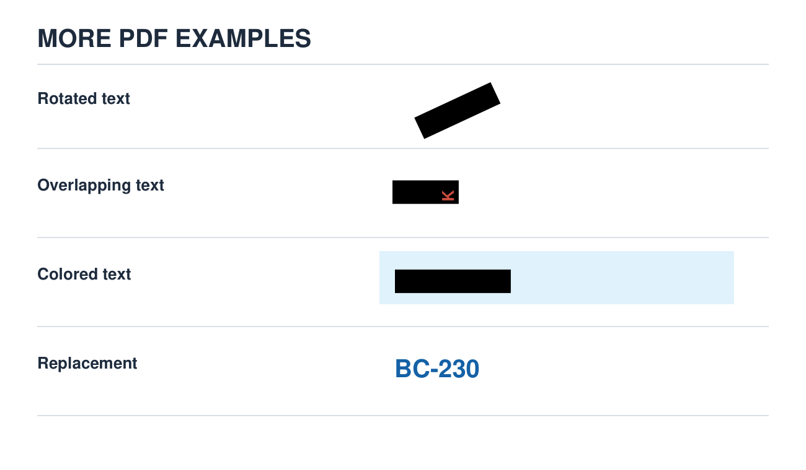

# Redaction MCP

Find sensitive text in a document, then **permanently redact it** or **replace it with sample data**. Use it from an MCP client such as ChatGPT, or through the FastAPI server. It supports text-based PDFs, DOCX, PPTX/PPTM, TXT, CSV, and XLSX.

**How it works:** document → `inspect_document` → `redact` or `replace` → check the output.

## With an AI agent

In the ChatGPT session, the agent identified the invoice fields, used Redaction MCP to remove them, verified the output, and returned the updated PDF. The metadata cleanup shown in the chat was a separate step performed by the agent.



## See it work

In this sample invoice, the invoice number, date, and product quantities are removed while the rest of the layout stays readable.

| Before | After redaction |
| :---: | :---: |
|  |  |

The PDF engine also handles text at an angle, text that overlaps other text, and colored text. Replacement removes the original value and inserts a new one.

| Before | After redaction or replacement |
| :---: | :---: |
|  |  |

The images above are sample PDFs processed by this project. In the last row, `AB-129` becomes `BC-230` using the `REGEX` replacement mode.

## Install and use

Requires Python 3.12 or newer.

```bash
python -m pip install redaction-mcp
```

Start the MCP server in HTTP mode:

```bash
redaction-mcp-http
```

Local MCP clients can connect to `http://127.0.0.1:8000/mcp`. For a client that launches its own server process, use `redaction-mcp-stdio`. To use ChatGPT, make the HTTP endpoint available at a reachable HTTPS URL and add that URL as an MCP connection.

Then attach a document and ask, for example:

> Redact the invoice number, invoice date, and product quantities from this PDF. Check the resulting document before returning it.

The server exposes `inspect_document`, `redact`, and `replace` tools. Keep the original file and check the output, including PDF metadata, before sharing it. See [DEVELOPMENT.md](DEVELOPMENT.md) for API requests, large-file jobs, and configuration.

## Limitations

PDF support is for **text-based PDFs**. Scanned PDFs need a specialized PII detection and removal pipeline with OCR, structure analysis, a custom redaction or replacement engine, and generation of a new document. For more information about such solutions, contact me at [zhimanshuk135@gmail.com](mailto:zhimanshuk135@gmail.com).
